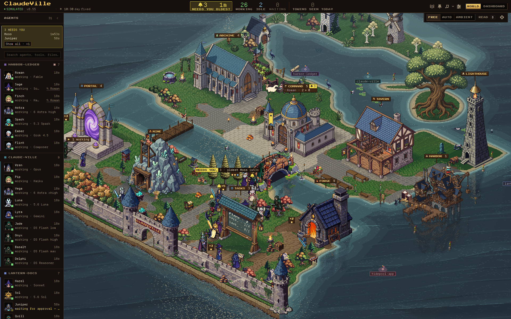
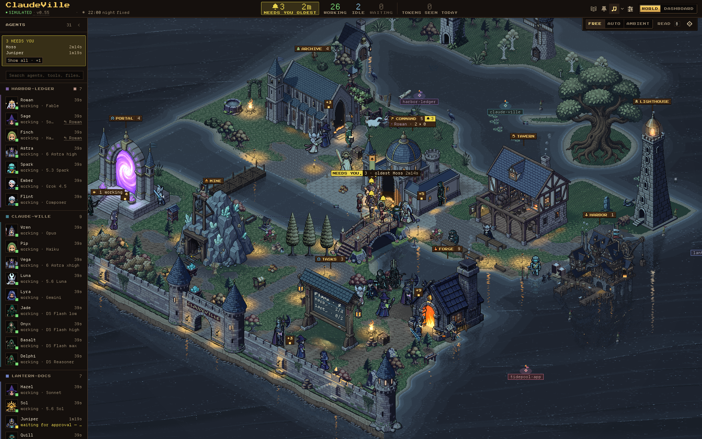
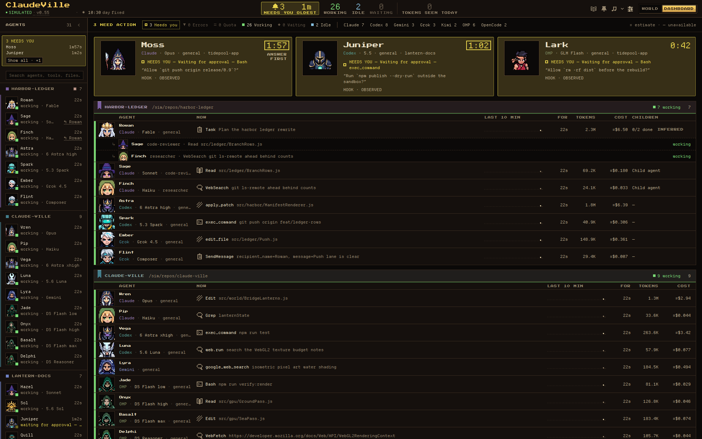
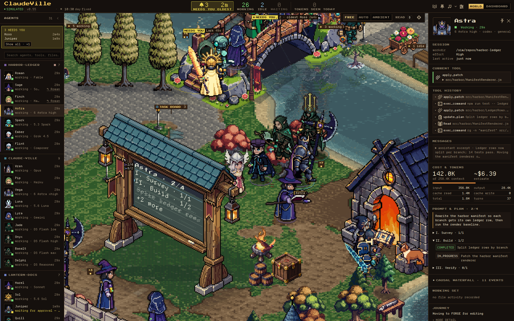
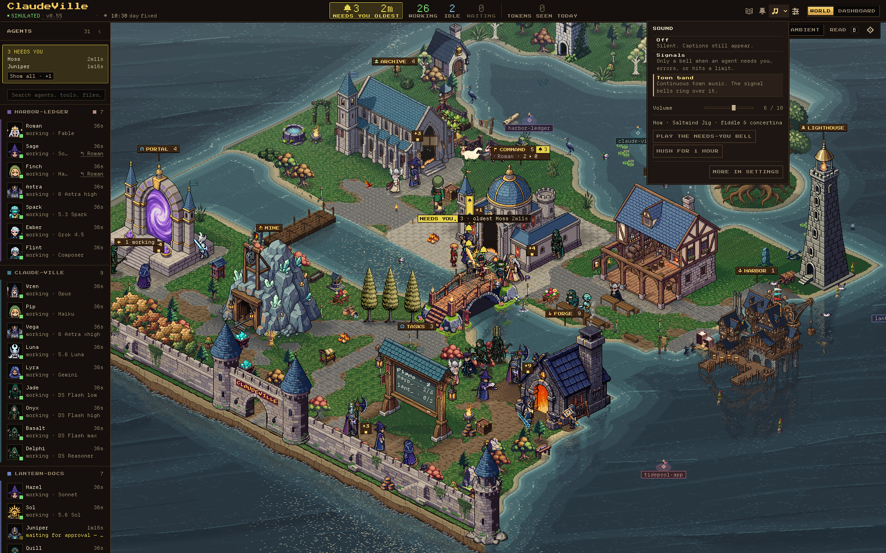

# ClaudeVille

**Keep an eye on every coding agent. Give them a village.**

[](https://github.com/TokenBrice/claude-ville/releases)
[](https://github.com/TokenBrice/claude-ville/actions/workflows/ci.yml)
[](./LICENSE)
[](./package.json)

ClaudeVille is a local dashboard for people running several AI coding agents across projects and providers. See who is working, who needs your approval, and where tokens are going—without cycling through every terminal.

Each session becomes a villager in a living pixel-art world. Leave it on a second monitor for a glance at your agents, then switch to Dashboard mode when you need the details. Your existing CLIs keep doing the work; ClaudeVille observes their session files read-only.



[Quick start](#quick-start) · [What you can see](#what-you-can-see) · [Providers](#supported-providers) · [Troubleshooting](./docs/troubleshooting.md) · [Changelog](./CHANGELOG.md)

## Quick start

You need **Node.js 22.7+**, Git, and a desktop browser at least **1280px wide**.

```bash
git clone https://github.com/TokenBrice/claude-ville.git
cd claude-ville
npm run dev
```

Open **[localhost:4000](http://localhost:4000)** and keep using your coding CLIs as usual. ClaudeVille discovers supported session stores on the same machine. No package install, build step, or ClaudeVille account is needed to run it.

**Try it before running agents:** open the [simulated village](http://localhost:4000/?sim=1&scenario=readme-showcase) after starting the server. It uses fictional sessions across all seven providers, including agents waiting for approval. All screenshots in this README use this simulator, with synthetic detail data for the Activity Panel.

No agents showing up? Start a CLI session and check [provider detection and session visibility](./docs/troubleshooting.md). The `/m/` profile has a touch layout for a server running on the phone itself; the desktop server binds to loopback and is not reachable from another device over your LAN.

## What you can see

| When you want to… | ClaudeVille shows you… |
| --- | --- |
| **Find the next agent that needs you** | Approval waits, errors, and rate limits in the top bar, sidebar, World attention plates, and Dashboard call cards. Press **A** in World mode to frame agents needing attention. |
| **Keep track of parallel work** | Agents grouped by project, provider and model identities, parent/child relationships, current tools, and plans where the provider records them. |
| **Investigate a session** | An Activity Panel with tool history, messages, prompt, working set, and a timeline. Dashboard rows expand inline for a closer look. |
| **Watch usage and cost** | Observed token totals, available context usage, and a spend map by project and provider. Cost may be provider-reported or estimated; missing data is not a zero bill. |
| **See work waiting to ship** | A Harbor ledger of unpushed commits by repository and branch, with ships in the World and departures for pushes. |
| **Look away without losing the thread** | Optional desktop notifications and sound signals for waits, errors, and limits. Sound starts off; the Town band adds a day/night soundtrack. |

Approval and status signals depend on what each CLI records. ClaudeVille distinguishes observed, inferred, and stale information; [optional lifecycle hooks](./docs/troubleshooting.md#permission-prompts-are-inferred-or-arrive-late) can improve approval detection. You approve commands and direct agents in their own CLI.

### World mode: awareness at a glance

Villagers head to the Forge to code, the Archive to read, and the Tavern to rest. Model families have their own sprites. The island changes with the local clock, seasons, and simulated weather; working buildings light up after dark.

Use the World dock to choose **FREE**, **AUTO**, or **AMBIENT** camera behavior. Press **F** to frame the village, hold **B** to read work labels, and use **/** or **Ctrl/Cmd+K** to find an agent. Click an agent to inspect its session.

<details>
<summary>See the village at night</summary>



</details>

### Dashboard mode: read the work

Scan project groups, current tools, recent activity, elapsed time, tokens, and costs. Call cards bring agents needing attention to the top; expand a row for session detail.



### Activity Panel: follow one agent

Select a villager or sidebar entry to inspect the session behind it, including its current tool, usage, messages, and plan when available.



<details>
<summary>See sound controls: Signals and Town band</summary>

Choose **Signals** for attention bells or **Town band** for music with the same alerts. The sound popover includes volume, a test bell, and a one-hour hush. **M** toggles sound.



</details>

## Supported providers

| CLI | Local session source |
| --- | --- |
| **Claude Code** | `~/.claude/` |
| **OpenAI Codex CLI** | `~/.codex/sessions/` |
| **Google Gemini CLI** | `~/.gemini/tmp/` |
| **xAI Grok CLI** | `~/.grok/sessions/` |
| **Kimi / Kimi Code** | `~/.kimi/sessions/` and `~/.kimi-code/sessions/` |
| **OpenCode** | `~/.local/share/opencode/opencode.db` |
| **OMP (Oh My Pi)** | `~/.omp/agent/sessions/` |
| **DeepSeek agents (deepseek-cc-mcp MCP server)** | `~/.local/state/deepseek-cc-mcp/` (or `DEEPSEEK_CC_STATE_DIR`) |

Providers are detected independently; you only need one, and the simulator needs none. OpenCode requires Node's `node:sqlite` or the `sqlite3` CLI for read-only database access. Model families served through another provider retain their identity, including DeepSeek and z.AI GLM through OMP.

See the [adapter reference](./claudeville/adapters/README.md) for provider-specific capabilities and the [model registry](./claudeville/src/config/models.json) for labels, pricing, context windows, and sprites.

## Local and read-only

- **Your session files stay on your machine.** The server binds to `127.0.0.1:4000`. ClaudeVille has no hosted backend or telemetry and does not write to provider session files.
- **Git inspection is read-only.** The Harbor queries active project repositories and GitHub checkouts under `~/Documents/git`. [Configure or disable repository discovery](./docs/troubleshooting.md#providers-detected-but-apisessions-is-empty) to suit your workspace.
- **Dashboard history stays in that browser.** Settings, the Chronicle, and the spend ledger use localStorage and IndexedDB.
- **Claude quota reporting makes an outbound request.** When existing Claude OAuth credentials include a subscription and access token, the server uses that token to request usage limits from Anthropic's API. Session transcripts are not sent with this request.

Review screenshots before sharing: live sessions can show prompts, messages, commands, project names, and file paths. Use the simulator for public captures. Report vulnerabilities through [the security policy](./SECURITY.md).

## Requirements and rendering

The runtime is a Node server plus static browser JavaScript, with no runtime dependencies. CI checks Node 22, 24 and 26.

World mode uses WebGPU on supported Chromium hardware, with WebGL2 and Canvas 2D fallbacks. Display P3 and WebGPU HDR highlights are available on compatible displays. If graphics fail, try [`?renderer=canvas`](http://localhost:4000/?renderer=canvas) and the [graphics troubleshooting guide](./docs/troubleshooting.md). Dashboard mode presents the same sessions as DOM rows.

## Contributing and support

Provider fixes, redacted fixtures, documentation, and focused visual improvements are welcome. Start with [CONTRIBUTING.md](./CONTRIBUTING.md) for development setup and checks. Development tools need `npm ci`; browser checks also need `npx playwright install chromium`.

- [Support](./SUPPORT.md) — setup help and where to report a problem.
- [Issues](https://github.com/TokenBrice/claude-ville/issues/new/choose) — reproducible bugs, provider parsing, and focused requests.
- [Discussions](https://github.com/TokenBrice/claude-ville/discussions) — ideas, questions, and new provider proposals.
- [Documentation index](./docs/README.md) — runtime ownership, rendering, sound, and contributor workflows.
- [Local server API](./docs/local-api.md) — HTTP endpoints and WebSocket updates.
- [Changelog](./CHANGELOG.md) — release history, also available from the version chip in the app.

ClaudeVille is a public fork of [honorstudio/claude-ville](https://github.com/honorstudio/claude-ville). This repository maintains the multi-provider version.

[MIT licensed](./LICENSE).
